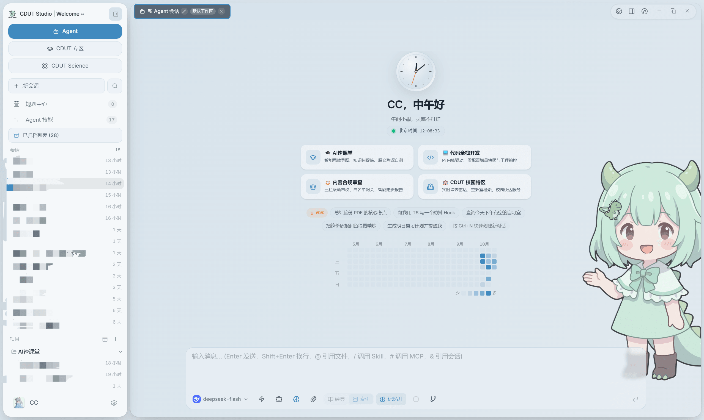
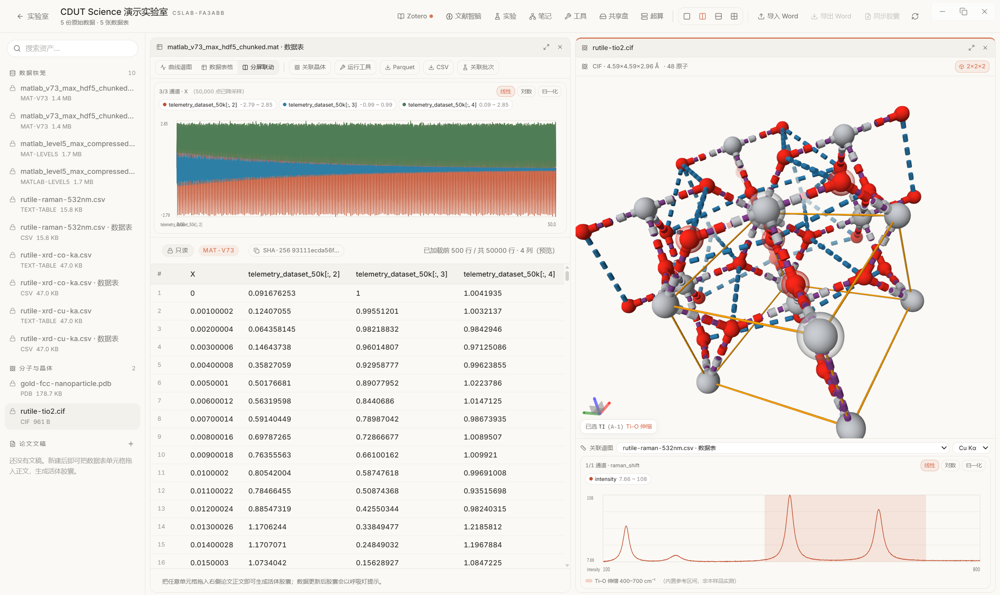
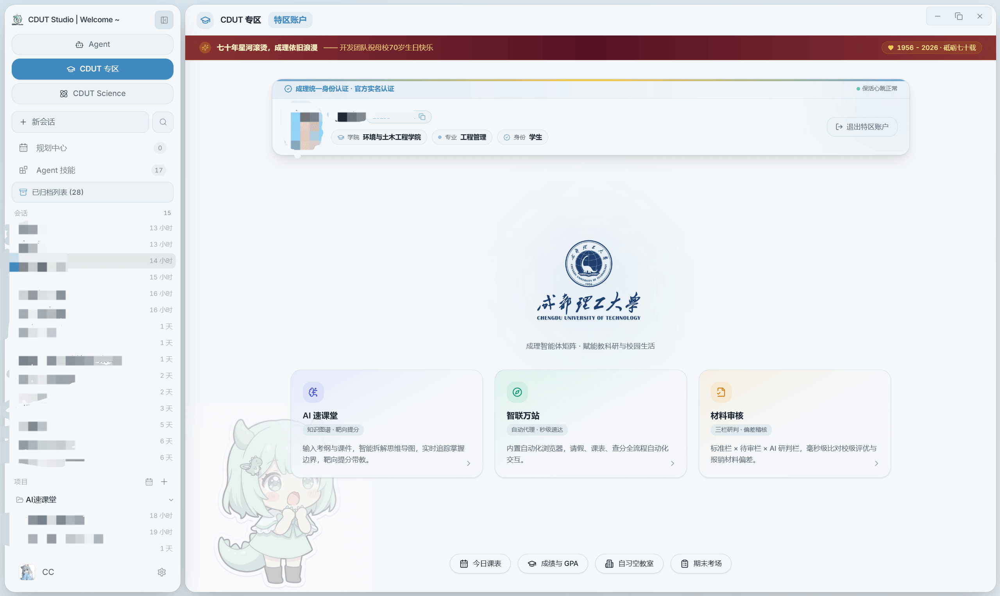
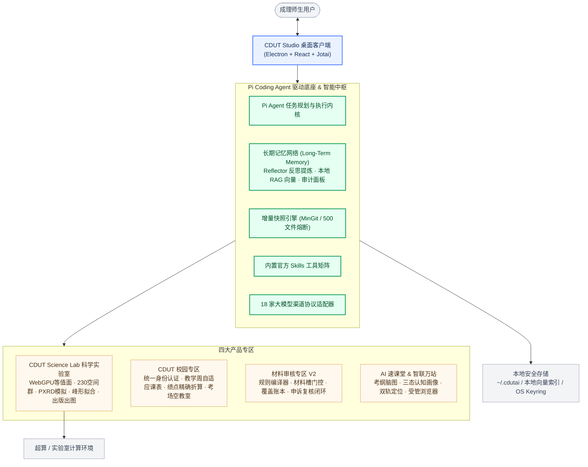

<p align="center">
  
</p>

<a id="cdut-studio-"></a>
<a id="top"></a>
# CDUT Studio 🦖
### 成都理工大学定制 AI 智能体工作台

<p align="center">
  <strong>“穷究于理，成就于工”</strong><br>
  专为成理师生打造的下一代端侧智能体协同平台：前沿科学计算 · 智能教务特区 · 工业级材料审核 · AI 速课堂 · 100% 本地优先
</p>

<p align="center">
  <a href="#-四大产品专区"></a>
  <a href="#multihop-rag-benchmark"></a>
  <a href="#-全景架构与技术栈"></a>
  <a href="#security-and-privacy"></a>
  <a href="LICENSE"></a>
</p>

<p align="center">
  <a href="#-四大产品专区">🌟 四大产品专区</a> •
  <a href="#-cdut-science-科学实验室">🔬 CDUT Science</a> •
  <a href="#-cdut-校园专区与教务特区">🏛️ 校园教务特区</a> •
  <a href="#-材料审核专区-v2">📑 材料审核 V2</a> •
  <a href="#-ai-速课堂与智联万站">🎯 速课堂 & 智联万站</a> •
  <a href="#-长期记忆与智能体底座">🧠 长期记忆与底座</a> •
  <a href="#multihop-rag-benchmark">🏆 MultiHop-RAG 评测</a> •
  <a href="#security-and-privacy">🛡️ 本地安全体系</a> •
  <a href="#-全景架构与技术栈">🏗️ 架构与技术栈</a> •
  <a href="#-遇见砚小龙">🦖 遇见砚小龙</a>
</p>

---

## 📖 项目简介

> **CDUT Studio** 是一款深度适配**成都理工大学**学术科研与校园生活生态的全功能端侧 AI 智能体（Agent）客户端。

系统以 **Pi Coding Agent 为唯一执行内核**，彻底践行 **100% 本地优先（Local-First）** 架构。无论是优势学科的深度科学计算、期末复习精准提分带教、校园教务自动化速查，还是复杂的奖助学金与公文材料多栏比对审核，CDUT Studio 都能化身为成理师生的“端侧赛博外脑”，用前沿智能体自动化流打破重复劳动，重构高校学习与科研范式。

<p align="center">
  
</p>

---

## 🌟 四大产品专区

<div align="center">
  <table>
    <tr>
      <td width="50%" valign="top">
        <h3>🔬 CDUT Science（科学实验室）</h3>
        <p><b>跨学科科学前沿工作台</b>：内嵌 Mol* 3D 渲染与 WebGPU 等值面切片管线、VESTA 级晶体学计算（230 空间群/配位多面体）、PXRD 粉末衍射谱仿真、Origin 级多峰卷积拟合、出版级矢量出图、HPC 调度与学术论文协同修订（Track Changes）。</p>
      </td>
      <td width="50%" valign="top">
        <h3>🏛️ CDUT 校园专区（教务特区）</h3>
        <p><b>成理数字校园原生互通</b>：统一身份认证一键安全接入、课表自适应教学周、学业成绩精准换算（五级制/两级制自动折算与同分去重）、考场与空教室秒级速查、学籍卡片规整展示与砚湖易办业务流轻量辅助。</p>
      </td>
    </tr>
    <tr>
      <td width="50%" valign="top">
        <h3>📑 材料审核专区 V2</h3>
        <p><b>三栏同屏审校工作台</b>：标准依据 × 送审材料 × AI 研判；内置自然语言规则编译器、必需材料槽门控（<code>minCount</code>）、版本链（<code>supersede</code>）、11 节点覆盖账本与申诉复核争议解决全流程闭环。</p>
      </td>
      <td width="50%" valign="top">
        <h3>🎯 AI 速课堂 & 智联万站</h3>
        <p><b>全景认知带教与受管浏览器</b>：考纲与课件脑图解构、<code>[完全掌握/模糊理解/完全盲区]</code> 三态动态画像、双轨证据定位锚点；内置多标签受管自动化浏览器，安全直通常用校内数字资源站点。</p>
      </td>
    </tr>
  </table>
</div>

---

<a id="cdut-science-科学实验室"></a>

## 🔬 CDUT Science (科学实验室)

围绕成都理工大学在地质古生物、资源勘查、核技术与自动化、材料化工与新能源等优势优势学科的科研需求，CDUT Studio 构建了从微观晶体结构、实验图谱拟合到宏观超算调度与学术出版的全链路计算系统：

<p align="center">
  
</p>

### 核心科研计算能力矩阵

| 科学计算模块 | 支持格式 / 标准 | 核心算法与技术底座 | 典型应用场景 |
| :--- | :--- | :--- | :--- |
| **晶体学与空间群** | `.cif`, `.poscar`, `.xyz` | 230 种空间群对称操作、消光规则判定、配位多面体（Polyhedra）解构 | 矿物晶体结构解析、晶胞变换、配位数与配位几何分析 |
| **PXRD 衍射模拟** | CIF 结构参数导出 | 运动学衍射理论（Kinematic Diffraction）、原子散射因子解析、Cu/Co 靶源 | 粉末 X 射线衍射谱理论计算、矿相标定与谱峰指认 |
| **3D 电子密度与等值面** | VASP `CHGCAR`, `LOCPOT`, Gaussian `.cube` | **WebGPU 原生 WGSL 着色器**、Marching Cubes 实时等值面切片与光照计算 | 差分电荷密度、静电势表面分布、电子自旋密度三维直观探索 |
| **多光谱拟合与数字化** | 图像/扫描件, `.csv`, `.txt` | Plot Digitizer 交互数字化、高斯/洛伦兹/Voigt 峰形拟合、LM 非线性优化 (Worker) | 实验谱图数据提取、XRD / Raman 多峰解卷积与基线扣除 |
| **出版级出图 (Figure Export)** | 高清 SVG / PNG 格式 | 自定义图例、误差棒、双坐标轴、符合 Nature/Science 排版规范的矢量排版 | 学术论文投稿图版生成、高分辨率科研图表一键导出 |
| **文献联动与论文修订** | Zotero 数据库, BibTeX, Markdown/LaTeX | 本地文献 GraphRAG、Track Changes 修订模式、侧栏边注（Marginalia） | 零上传直读本地文献、审稿意见协同修改、公式与引用补全 |

---

<a id="cdut-校园专区与教务特区"></a>

## 🏛️ CDUT 校园专区与教务特区

针对成理校园日常学习与教务查询需求量身定制，在安全合规边界内全面消除重复查课表、登录繁琐与事务填报负担：

<p align="center">
  
</p>

### 1. 特区账户一键接入与安全保护
- **原生卡片式免跳转登录**：输入学工号完成统一身份认证，界面零白屏、零外部弹窗；
- **凭据硬件级加密存储**：账号信息由操作系统 `safeStorage`（DPAPI / Keychain）加密持久化于本地，绝不上报云端，后台自动维持安全会话；
- **真实身份卡片**：自动规整姓名、学工号、学院专业及学籍证件照，生成专属身份卡片。

### 2. 便捷教务服务
- **课表全景透视**：自动对齐北京时间教学周，清晰掌握当天及全周课程编排、上课教室与授课教师；
- **成绩与绩点精确折算**：完整支持百分制、五级制（优/良/中/及格/不及格）及两级制（合格/不合格）自动映射，多次考核同分自动聚合最新学期；
- **考场速查与空教室检索**：一键查询期末排考安排，按教学楼栋、时段智能检索自习空教室；
- **砚湖易办轻量辅助**：以自然语言对话引导表单信息流转，协助快速梳理请假申报理由。

---

<a id="材料审核专区-v2"></a>

## 📑 材料审核专区 V2

面向班级评优、奖助学金材料申报、项目申报等公文审校场景打造的工业级三栏审校工作台：

```
┌─────────────────────────┬─────────────────────────┬─────────────────────────┐
│ 📌 左栏：审核标准依据库  │ 📄 中栏：送审材料与槽位  │ ✅ 右栏：AI 研判与覆盖账本 │
├─────────────────────────┼─────────────────────────┼─────────────────────────┤
│ • 评奖细则与公文规范原文  │ • 必需材料槽门控 minCount│ • 11 节点确定性与网关协同 │
│ • 负责人规则文本编译器  │ • 槽位同名文件版本链追踪│ • 覆盖账本 CoverageLedger│
│ • 结构化规则解析与版本链 │ • PDF / Word / Excel 解析 │ • 初审/补件/申诉复核闭环 │
└─────────────────────────┴─────────────────────────┴─────────────────────────┘
```

- **负责人规则文本编译器 (`compileOwnerRules`)**：直接粘贴通知公文，系统自动逐行提取条款、严重度括号与条目编号，编译为结构化标准规则；
- **材料槽门控与覆盖账本**：针对必须提交的材料槽位（如“成绩单”、“获奖证书”）进行严格数量校验，检查结果按分组规则逐项展开覆盖账本，无规则或未执行处如实标注；
- **争议解决全生命周期**：支持完整的「初审驳回 ➔ 补充材料 ➔ 再次复核 ➔ 维持原判/更正定稿」合规流转机制。

---

<a id="ai-速课堂与智联万站"></a>

## 🎯 AI 速课堂与智联万站

### 1. AI 速课堂：期末极速提分带教
- **知识图谱与脑图生成**：拖入课件 PPT、教材 PDF 与考纲，Agent 自动梳理核心脉络并渲染为交互思维导图；
- **三态动态认知画像**：将考点精准定位为 `[完全掌握]`、`[模糊理解]`、`[完全盲区]`，针对薄弱点实施启发式推题；
- **双轨定位锚点**：回答引用直接生成交互胶囊，点击即可在侧栏预览面板秒级定位至具体文档页码、表格或图表块。

### 2. 智联万站：受管自动化浏览器
- **多标签安全隔离**：内置现代化受管浏览器标签页，畅联校内外任意安全站点；
- **校园直通生态**：预置成理教务处、图书馆、砚湖易办、易班等校内高频书签，支持视窗截图与自动化辅助。

---

<a id="长期记忆与智能体底座"></a>

## 🧠 长期记忆与智能体底座

CDUT Studio 以 **Pi Coding Agent 为唯一执行内核**，在提供强大任务规划与工具调度的同时，最新引入了革命性的**长期记忆与反思网络（Long-Term Memory）**：

```
                    ┌── 异步反思提炼引擎 (Reflector: 认知偏好 / 习惯 / 纠错归纳)
Pi 智能体驱动底座 ──┼── 本地透明审计向量存储 (Auditor & Local RAG Store)
                    ├── 设置页全生命周期记忆管理面板 (查看 / 检索 / 编辑 / 删除)
                    ├── 三层 Context Sandwich 提示词安全沙盒 (静态 ➔ 系统 ➔ 用户)
                    └── 18 家主流模型协议原生适配 (DeepSeek / Gemini / Claude 等)
```

- **反思引擎自动提炼（Reflector）**：Agent 在执行多轮任务后，自动于后台对交互过程进行认知剖析，提炼出用户的编程习惯、科研偏好与纠错教训，实现“越用越懂你”；
- **本地审计与透明管理（Auditor & View）**：所有提炼的记忆条目完全以本地 JSON 存储并建立本地向量索引。用户可在「设置 → 长期记忆」中随时审查、全文检索、微调修改或一键清除，记忆资产 100% 掌握在自己手中；
- **增量检查点引擎**：毫秒级快照每一次文件修改，支持随时一键无损回滚，内置 MinGit 引擎保障零外部依赖开箱即用。

---

<a id="multihop-rag-benchmark"></a>

## 🏆 MultiHop-RAG 权威基准评测

CDUT Studio 校园知识库（RAG）基于官方全集 **MultiHop-RAG（2556 题，涵盖推断/对比/时序/空查询四大复杂题型）** 进行评测：

| 检索引擎 | 参评题数 | Hit@4 | Hit@10 | Recall@4 | Recall@10 | MRR | MAP@10 | Null 拒答率 | 平均耗时 |
| :--- | :---: | :---: | :---: | :---: | :---: | :---: | :---: | :---: | :---: |
| **Classic (默认主引擎)** | 2255 | **92.95%** | **98.85%** | **62.91%** | **81.81%** | **0.7942** | **0.5867** | 70.76% | 1.1s |
| **GraphRAG** | 2255 | 87.58% | 96.14% | 52.86% | 73.18% | 0.7103 | 0.4843 | **85.05%** | 1.1s |

> **核心可信性审计**：全量 6084 条金标证据条目 100% 成功回溯至语料库；针对空查询（Null Query）通过分值自校准机制实现高置信拒答，避免大模型幻觉编造。详细评测报告见 👉 [MultiHop-RAG 评测完整技术报告](assets/MultiHop-RAG-Scores/multihop-rag-report.md)。

---

<a id="security-and-privacy"></a>

## 🛡️ 本地安全防线与离线公告体系

CDUT Studio 坚守**本地优先（Local-First）**与数据私有承诺，全链路装配五重防御保障：

- **硬件级凭据加密**：所有模型 API 密钥与特区账户凭据均由操作系统 `safeStorage`（DPAPI / Keychain）加密保存在本地 `~/.cdutai/` 目录，杜绝隐私外泄；
- **沙箱隔离与快照熔断**：无工作区会话自动置于安全沙箱，对用户主目录与驱动器根目录绝对拒止快照，物理复制附带 500 文件安全熔断；
- **离线安全公告体系（Bulletin）**：应用随安装包内置发布通告与安全通知，不发起任何新闻类外部轮询，保持系统透明、极简、无后门；
- **网络传输安全插页**：内置受管浏览器集成高危证书告警与交互式安全插页，全链路过滤 C0 控制字符与截断风险，守护校园网络交互安全。

---

<a id="全景架构与技术栈"></a>

## 🏗️ 全景架构与技术栈

### 全景工作台架构



### 现代工程化技术选型

| 层级 | 技术选型 | 说明 |
| :--- | :--- | :--- |
| **运行时** | **Bun** 1.2.5+ (推荐 1.4.2+) | 统一使用现代高效 JS/TS 运行时，极速包解析与脚本执行 |
| **桌面框架** | **Electron** 43.2.0 | 主进程/Preload 采用 esbuild 极速构建，渲染端由 Vite 驱动 |
| **前端体系** | **React** 18 + **Tailwind CSS** + **Radix UI** | 函数式组件规范，精致卡片与立体层次交互设计 |
| **图形与计算** | **WebGPU (WGSL)** + **Mol*** + tipTap + KaTeX | 现代 WebGPU 标量场等值面渲染，3D 晶体分子视窗与 LaTeX 排版 |
| **状态管理** | **Jotai** 2.17.1 | 全局与局部状态原子化管理，杜绝状态穿透与无效渲染 |
| **执行内核** | **Pi Coding Agent** (`@earendil-works/pi-*`) | 唯一执行内核，驱动规划、长期记忆反思与工具调度 |
| **工程架构** | **Bun Workspace Monorepo** | 包含 `packages/core`, `packages/shared`, `apps/electron` 等严谨解耦模块 |
| **分发打包** | **Electron Builder** 25.1.8 | 支持 Windows NSIS / 便携免安装版及跨平台打包 |

---

<a id="快速上手"></a>

## ⚡ 快速上手

### 📋 环境要求
* **Bun** >= 1.2.5 (推荐 1.4.2+)
* **Git** (可选，Windows 客户端内置 MinGit 引擎)

### 🚀 安装与启动

1. **克隆仓库**
   ```bash
   git clone https://github.com/Nya-Angle/CDUT-Studio.git
   cd CDUT-Studio
   ```

2. **安装 Monorepo 依赖**
   ```bash
   bun install
   ```

3. **启动开发环境**
   ```bash
   bun run dev
   ```

4. **工程规范校验**
   ```bash
   bun run typecheck
   ```

---

<a id="遇见砚小龙"></a>

## 🦖 遇见“砚小龙”

<div align="center">
  <table>
    <tr>
      <td width="30%" align="center">
        <br>
        <b>嗷呜！我是 CDUT Studio 的「砚小龙」~</b>
      </td>
      <td width="70%" align="left">
        <h3>💚 诞生于成理恐龙博物馆与砚湖湖畔的 AI 守护神</h3>
        <p>成理不仅有享誉世界的<b>马门溪龙</b>，更有守护每个深夜赶 DDL 与学术攻关的“砚小龙”！</p>
        <ul>
          <li>🌱 <b>恐龙睡袍与小角</b>：象征成理地学与地质古生物的深厚历史积淀；</li>
          <li>🎀 <b>砚湖绿缎带</b>：取自砚湖春水色，陪伴你在知识与科学的湖泊中探索成长；</li>
          <li>🐾 <b>桌面伴学宠物（Floating Pet）</b>：支持将砚小龙呼唤至桌面任意角落，静静守候你的科研时光；</li>
          <li>🕰️ <b>拟物时钟与活跃热力图</b>：桌面端贴心挂载 Analog Clock 与 Usage Heatmap，直观记录你的学术成长轨迹。</li>
        </ul>
      </td>
    </tr>
  </table>
</div>

<details>
<summary><b>🔍 查看「砚小龙」三视图设计资产</b></summary>
<div align="center">
  <br>
  
  
  
  <p><i>CDUT Studio 吉祥物标准三视图 —— 可适配 3D 界面与虚拟形象小组件</i></p>
</div>
</details>

---

## 👥 开发团队

<div align="center">

> 🦖 **CDUT Studio Core Team** · 穷究于理，成就于工

</div>

<div align="center">
<table>
  <tr>
    <td width="50%" valign="top">
      <div style="display: flex; gap: 12px; align-items: flex-start;">
        
        <div>
          <b>队长</b><br/>
          <sub>成都理工大学学生 &nbsp;·&nbsp; 队长</sub><br/>
          <sub><b>负责方向：</b>CDUT Science Lab 架构设计、长期记忆系统研发、智联万站与 AI 速课堂研发、RAG 检索增强算法、特区账户技术接入、「砚小龙」IP 形象设计</sub>
        </div>
      </div>
    </td>
    <td width="50%" valign="top">
      <div style="display: flex; gap: 12px; align-items: flex-start;">
        
        <div>
          <b>核心成员</b><br/>
          <sub>成都理工大学学生 &nbsp;·&nbsp; 核心队员</sub><br/>
          <sub><b>负责方向：</b>材料审核专区 V2 研发、项目图像视觉资源设计、客户端 UI 与卡片式交互体验</sub>
        </div>
      </div>
    </td>
  </tr>
  <tr>
    <td colspan="2" valign="top">
      <div style="display: flex; gap: 14px; align-items: flex-start;">
        
        <div>
          <b style="font-size: 16px;">特别鸣谢成员</b> &nbsp; <a href="https://github.com/Yuan-lai-ru-ci/ProferAI" target="_blank"></a><br/>
          <sub><b>特别鸣谢 & 核心成员</b></sub><br/>
          <sub><b>突出贡献：</b>衷心感谢该成员为本项目提供优秀的基座支持，并在客户端底层通信与架构选型中提供坚实的技术支撑！推荐关注其开源 Agent 项目 👉 <a href="https://github.com/Yuan-lai-ru-ci/ProferAI" target="_blank"><b>ProferAI</b></a>。</sub>
        </div>
      </div>
    </td>
  </tr>
  <tr>
    <td width="50%" valign="top">
      <div style="display: flex; gap: 12px; align-items: flex-start;">
        
        <div>
          <b>核心成员</b><br/>
          <sub>成都理工大学学生 &nbsp;·&nbsp; 核心队员</sub><br/>
          <sub><b>负责方向：</b>核心交互功能设计、RAG 知识库工程构建、全流程技术架构与部署文档撰写</sub>
        </div>
      </div>
    </td>
    <td width="50%" valign="top">
      <div style="display: flex; gap: 12px; align-items: flex-start;">
        
        <div>
          <b>核心成员</b><br/>
          <sub>成都理工大学学生 &nbsp;·&nbsp; 核心队员</sub><br/>
          <sub><b>负责方向：</b>砚湖易办业务流逻辑梳理、学业场景需求设计、系统功能手册与用户操作指南设计</sub>
        </div>
      </div>
    </td>
  </tr>
</table>
</div>

---

## 📜 许可证与免责声明

本项目基于 **GNU Affero General Public License v3.0 (AGPL-3.0)** 开放源代码。详见 [LICENSE](LICENSE) 文件。

*免责声明：CDUT Studio 为成理学生自主开源 AI 智能体项目，非官方商业软件，旨在促进开源技术交流、学术科研效率与校园数字化学习体验提升。*

<br/>

<div align="center">
  <p><b>穷究于理，成就于工 · 攀登科学高峰，从 CDUT Studio 开始。</b></p>
  
  <br/><br/>
  <sub>CDUT Studio is an independent open-source project by <b>@雫窝中央实验室</b>. © 2026.</sub>
  <br/><br/>
  <a href="#cdut-studio-">⬆ 返回顶部</a>
</div>
