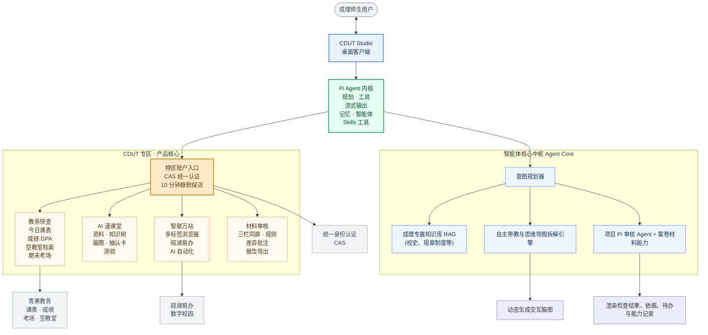

<p align="center">
  
</p>

# CDUT Studio 🦖
### 成都理工大学定制 AI 智能体工作台

<p align="center">
  <strong>“穷究于理，成就于工”</strong><br>
  专为成理师生打造的下一代端侧智能体协同平台：高效 AI 带教 · 智能材料审核 · 智能化浏览器 · 特区账户接入 · RAG 检索辅助
</p>

<p align="center">
  <a href="#-cdut-专区三大核心模块"></a>
  <a href="#multihop-rag-benchmark"></a>
  <a href="#-技术栈构成"></a>
  <a href="#security-and-privacy"></a>
  <a href="LICENSE"></a>
</p>

<p align="center">
  <a href="#-cdut-专区三大核心模块">🌟 核心三大模块</a> •
  <a href="#multihop-rag-benchmark">🏗️ 架构原理解析</a> •
  <a href="#-快速上手">⚡ 一分钟启动</a> •
  <a href="#security-and-privacy">🛡️ 网络安全防护</a> •
  <a href="#-遇见砚小龙">🦖 认识砚小龙</a> •
  <a href="#-开发团队">👥 开发团队</a>
</p>

---

## 📖 项目简介

> **CDUT Studio** 是一款深度适配**成都理工大学**校园生态的全功能端侧 AI 智能体（Agent）客户端。

它在保留通用 Agent 强大规划与推理能力的基础上，深度融入了**成理专有校园知识库（RAG）**与**自动化内网引擎**。无论是期末突击自救、繁重教务流程办理，还是复杂的学术材料与班务文档审核，CDUT Studio 都能化身为成理学子的“赛博外脑”，用自动化智能流打破重复劳动，重构高校学习与科研体验。

<div align="center">
  <table>
    <tr>
      <td width="33%" align="center">
        <h3>🎯 AI 速课堂</h3>
        <p>输入考纲与课件，智能拆解思维导图，实时追踪掌握边界，靶向提分带教。</p>
      </td>
      <td width="33%" align="center">
        <h3>🌐 智联万站</h3>
        <p>内置定制浏览器：支持任意网站访问与 AI 自动化操作（默认内置校内书签，不构成访问限制）。</p>
      </td>
      <td width="33%" align="center">
        <h3>📑 材料审核</h3>
        <p>标准栏 × 待审栏 × AI 研判栏，高效率完成比对校级评优与提交材料偏差。</p>
      </td>
    </tr>
  </table>
</div>


---

## 🦖 遇见“砚小龙”

<div align="center">
  <table>
    <tr>
      <td width="30%" align="center">
        <br>
        <b>嗷呜！我是 CDUT Studio 的「砚小龙」~</b>
      </td>
      <td width="70%" align="left">
        <h3>💚 诞生于成理恐龙博物馆与砚湖湖畔的 AI 守护神</h3>
        <p>成理不仅有享誉世界的<b>马门溪龙</b>，更有守护每个深夜赶 DDL 的“砚小龙”！</p>
        <ul>
          <li>🌱 <b>恐龙睡袍与小角</b>：象征成理地学与地质古生物的厚重积淀；</li>
          <li>🎀 <b>砚湖绿缎带</b>：取自砚湖春水色，陪伴你在知识的湖泊中乘风破浪；</li>
          <li>⚡ <b>情绪感知引擎</b>：当你在期末周抓狂时，她会在工作台右下角提醒你喝水，并默默为你生成下一章节的复习重点。</li>
        </ul>
      </td>
    </tr>
  </table>
</div>

<details>
<summary><b>🔍 查看「砚小龙」三视图设计资产</b></summary>
<div align="center">
  <br>
  
  
  
  <p><i>CDUT Studio 吉祥物标准三视图 —— 可适配 3D 界面与虚拟形象小组件</i></p>
</div>
</details>

---

## 🔥 CDUT 专区三大核心模块

### 1. 🎓 自主学习：期末极速提分带教引擎

告别海量 PPT 带来的复习焦虑。自主学习模块具备**自主知识深度解构**与**学习边界追踪**能力：

* 🧠 **知识图谱与脑图生成**：拖入 PPT、教材 PDF、复习考纲，Agent 自动提炼核心主干并渲染为交互式思维导图。
* 📊 **学习认知区间动态画像**：将知识点清晰划分为 `[完全掌握]`、`[模糊可理解]`、`[完全盲区]`，避免盲目刷题。
* 🎯 **苏格拉底式靶向带教**：模拟成理名师启发式提问，直击易错点与核心考点，以最高时间回报率迎战期末。

```
[原始课件/教材] ➔ [知识单元解构] ➔ [认知边界动态探测] ➔ [靶向带教推题] ➔ 🏆 稳过高分
```

---

### 2. 🏛️ 砚湖易办：内网全自动化无人值守

项目内置专属自动化浏览器核心，安全挂载于本地沙盒环境中，直通成理“砚湖易办”等数字校园系统。

* 🔐 **特区账户一键接入**：
  * **原生卡片式登录**：输入学工号与密码即可连接，后台静默驱动统一身份认证（CAS），界面零跳转、零白屏，不打断当前会话。
  * **身份画像自动抓取**：登录成功后自动解析姓名、学工号、学院、专业与真实头像，生成专属身份名片。
  * **本地加密凭据**：密码经操作系统 safeStorage 级加密后落盘 `~/.cdutai/cdut-account.json`，绝不经任何第三方服务器中转。
  * **静默在线保活**：每 10 分钟后台心跳探活，会话过期自动如实提示，绝不“假装成功”。
* 🤖 **学生端自动化功能集**：
  * **智能带教助手**：多智能体协作，结合教务平台进度智能督导。
  * **自动请假申办**：结构化表单对话，一键完成理由填充与流程流转。
  * **全景学业雷达**：一键聚合课表查询、空闲自习室探测、期末成绩与绩点秒级抓取。
* 🛡️ **安全规范（特权保护机制）**：
  > ⚠️ **网络安全特别声明**：为践行责任开源原则，彻底规避内部敏感接口外泄风险，我方网络安全组决定**严禁适配与开放教师端特权操作功能**。本客户端仅运行于受限的学生身份上下文环境中。

---

### 3. 📑 材料审核：案卷式审核工作台

面向奖助评审、综测成果、班级事务和报销材料等场景。每次审核以一个案卷组织模板、分项、规则和多份材料，由项目 Pi Agent 执行通用推理，审核专区按案卷提供受限的文档能力。

```
┌───────────────────────┬───────────────────────┬───────────────────────┐
│  📌 左栏：审核标准依据   │  📄 中栏：送审材料文件   │ ✅ 右栏：AI 审核研判报告 │
├───────────────────────┼───────────────────────┼───────────────────────┤
│ • 可编辑的审核模板与规则 │ • PDF/Office/表格等材料 │ • 检查状态与逐项说明     │
│ • 可单独上传规则材料     │ • 按需读取文本/表格块   │ • 引用位置与待办         │
│ • 覆盖多个审核分项       │ • 需要时核验指定图像页 │ • 能力调用与模型用量     │
└───────────────────────┴───────────────────────┴───────────────────────┘
```

* **材料能力按需调用**：Agent 可以列出案卷材料、检索文本、按块/工作表/行读取，并针对影响结论的单页调用视觉核验；不把所有正文和图像预先塞进提示。
* **受控结论**：自动结论需要真实材料块引用；规则材料未完整读取、证据不足或需要负责人确定的事项保留为待确认/待补件。
* **运行可追踪**：审核结果显示检查状态、引用依据、材料能力调用和可取得的模型 token 用量。默认由审核人员处理结果；启用批次自动化后，也只有满足严格准入条件的案卷才会写入正式决定。

批量审核的当前实现状态、边界、测试记录和接手步骤见[开发者交接文档](docs/design/review-agent/17-current-state-and-handoff.md)。当前功能分支包含批次队列执行/恢复、技术异常定向重试、问题组预览与人工确认后逐案处置，以及需逐批授权和严格门控的自动补件/通过；这不代表接入了学校身份或远端审批。

离线演示入口与最终独立验收见[批量审核复验报告](docs/design/review-agent/24-batch-review-independent-final-acceptance.md)：失败提示包含真实失败数量，全部执行失败时待人工分流为零，旧自动处置单独显示为历史回执。

测试仓库现已整合上游 PDF/RAG 更新与审核模块，整合依据和冲突处理见[上游整合记录](docs/design/review-agent/25-upstream-review-integration.md)。当前阶段产物将以 Draft PR 提交上游评审，已完成与未完成部分见[阶段交付状态](docs/design/review-agent/28-review-stage-delivery-status.md)：模块化模板完成初次验证后仍在开发，大批试测模板未纳入提交，富文本完整解析等待上游更新。

直接案卷审核的 Pi 阶段已在测试仓库 Draft PR #21 接入 Main 后台入口：Main 创建内部会话、等待真实受理后持续执行，用户在案卷查看结果与停止；普通聊天列表不显示新内部会话。材料准备与事项识别仍在前台，需等待“审核中，可切换页面”后再离开。已有普通审核聊天不批量迁移。启动恢复会先拒绝旧运行授权，再原子保存中断状态；存储故障时拒止仍生效，不能把未落盘状态当作恢复完成。实施边界见[最小规范](docs/design/review-agent/27-background-review-session-proposal.md)，当前验收、实机复验与外部阻断见[证据台账](docs/design/review-agent/29-background-session-preflight-audit.md)。当前仍为开发阶段，未合并或放行完整生产链路。Main/A0 历史证据见 [34 号](docs/design/review-agent/34-pre-p06-main-a0-acceptance-20261013.md)，P06 原始实机失败与累计审计分别保留在 [37 号](docs/design/review-agent/37-p06-s02-local-acceptance-20261013.md)和 [38 号](docs/design/review-agent/38-p01-p06-s02-cumulative-risk-audit-20261013.md)。

上游后续照片蒙版与空闲态压缩已同步，离线审核入口和批量页面已通过实际 `bun run dev` 回放，结果见[dev 复验记录](docs/design/review-agent/26-upstream-refresh-dev-acceptance.md)。

2026-10-15 同步：本仓库 main 将整合原项目 `c179f257` 与审核分支 `60e805cf` 的完整受控源码。通用 Office 解析使用上游新引擎，文件预览使用只读侧栏；审核材料引用继续保留弹窗入口和专用 DOCX/XLSX 结构提取。同步记录见 [48 号](docs/design/review-agent/48-upstream-cloud-main-integration-20261015.md)。P06 实机结论继续限定于原冻结版本，未签收门禁不因本次 main 同步而升级；后续工作按 [47 号](docs/design/review-agent/47-p06-evidence-driven-followup-plan-20261015.md) 执行。

Pi 工具执行接入 Main 的权限回调，普通会话的自动审批、计划模式和手动拒止采用既有权限服务。审核专用工具继续核验本轮案卷指派，完整兼容矩阵以 29 号验收台账为准。

同一份合成综测案卷的基线与能力库复跑记录见 [审核 Agent 能力库对照](outputs/template-review-suite-2026-10-08/run-results-deepseek-capabilities/COMPARISON.md)。该单案测试显示材料覆盖从 0/4 个被记为已读提高到 4/4、修正了一个错误自动通过；总 token 约下降 6.6%，耗时约增加 1.9 秒。基线把文本材料预注入提示，但没有逐份读取日志，故 0/4 指能力覆盖记账，不表示模型完全没看到文本材料。

---

<a id="multihop-rag-benchmark"></a>

## 🏗️ 工作台架构与 CDUT 专区

> 以 CDUT 专区为产品核心：特区账户统一接入后，串联教务快查、AI 速课堂、智联万站与材料审核；Pi Agent 与本地沙盒构成通用底座。



通用底座由 Pi Agent 统一驱动：会话与记忆、多智能体协作、Skills 与工具、定时任务、18 家模型渠道，以及基于文件检查点 / MinGit 的本地沙盒和 `~/.cdutai` 本地存储。

---

## 🛠️ 技术栈构成

本项目采用现代全栈工程化体系，以极致响应速度与严苛内存控制为第一准则：

| 核心领域 | 所用技术 | 占比与生态徽标 |
| :--- | :--- | :--- |
| **客户端前端** | TypeScript, React, Tailwind CSS |   |
| **Agent / 自动化** | Python, Playwright, LangChain |   |
| **渲染与版式** | HTML5 Canvas, Modern CSS |   |
| **脚本与自动化构建** | JavaScript, PowerShell, Shell |   |

---

## ⚡ 快速上手

### 📋 环境要求
* **Bun** >= 1.2.5 (推荐 1.4.2+)
* **Git** (可选，Windows 端应用已内置精简版 MinGit)

### 🚀 安装与启动

1. **克隆仓库至本地**
   ```bash
   git clone https://github.com/Nya-Angle/CDUT-Studio.git
   cd CDUT-Studio
   ```

2. **安装核心依赖项**
   ```bash
   bun install
   ```

3. **配置模型密钥与端点**
   启动应用后，在「设置 → 渠道配置」中添加你偏好的大模型提供商
   (DeepSeek / 智谱 / MiniMax / 豆包 / 通义千问 / 自定义端点)。
   密钥经过加密后保存在本地文件中。

4. **启动开发客户端**
   ```bash
   bun run dev
   ```

---

## <a id="security-and-privacy"></a>🛡️ 安全与隐私防线

<div align="center">
  <table>
    <tr>
      <td width="20%" align="center">🔐<br><b>零上传隐私锁</b></td>
      <td>所有教务网登录凭证仅在本地沙盒 Keyring 加密存放，不经过任何第三方服务器中转。</td>
    </tr>
    <tr>
      <td width="20%" align="center">🧪<br><b>本地沙盒运行</b></td>
      <td>自动化浏览器运行于受限沙盒，严格隔离 Cookie、Session 与操作轨迹，用完即弃。</td>
    </tr>
    <tr>
      <td width="20%" align="center">⚖️<br><b>伦理与合规边界</b></td>
      <td>严格遵循校园信息化安全规范，请求频率受动态限流保护，确保对校内服务器零压力、高友好。</td>
    </tr>
  </table>
</div>

---

## 📜 许可证

本项目基于 **GNU General Public License v3.0 (GPL-3.0)** 开放源代码。详见 [LICENSE](LICENSE) 文件。

*免责声明：CDUT Studio 为成理学生开源 Agent 项目，非官方商业软件，旨在促进开源技术交流与学习效率提升。*

---

## 👥 开发团队

<div align="center">

> 🦖 **CDUT Studio Core Team** · 攀登科学高峰，成就工匠精神

</div>

<!-- 2-1-2 团队成员与致谢（无边框卡片布局） -->
<div align="center">
<table>
  <tr>
    <td width="50%" valign="top">
      <div style="display: flex; gap: 12px; align-items: flex-start;">
        
        <div>
          <b>队长</b><br/>
          <sub>成都理工大学学生 &nbsp;·&nbsp; 队长</sub><br/>
          <sub><b>负责方向：</b>智联万站模块研发、 AI 速课堂模块研发、 RAG 算法设计开发、特区账户技术支持、「砚小龙」IP 形象设计</sub>
        </div>
      </div>
    </td>
    <td width="50%" valign="top">
      <div style="display: flex; gap: 12px; align-items: flex-start;">
        
        <div>
          <b>核心成员</b><br/>
          <sub>成都理工大学学生 &nbsp;·&nbsp; 核心队员</sub><br/>
          <sub><b>负责方向：</b>材料审核模块研发、项目图像资源设计、客户端 UI 与项目视觉设计</sub>
        </div>
      </div>
    </td>
  </tr>
  <tr>
    <td colspan="2" valign="top">
      <div style="display: flex; gap: 14px; align-items: flex-start;">
        
        <div>
          <b style="font-size: 16px;">特别鸣谢成员</b> &nbsp; <a href="https://github.com/Yuan-lai-ru-ci/ProferAI" target="_blank"></a><br/>
          <sub><b>特别鸣谢 & 核心成员</b></sub><br/>
          <sub><b>突出贡献：</b>衷心感谢该成员为本项目提供优秀的基座支持，并在客户端通信与架构选型中提供优秀的技术基础！在这里也推荐大家关注其开源 Agent 项目 👉 <a href="https://github.com/Yuan-lai-ru-ci/ProferAI" target="_blank"><b>ProferAI</b></a>。</sub>
        </div>
      </div>
    </td>
  </tr>
  <tr>
    <td width="50%" valign="top">
      <div style="display: flex; gap: 12px; align-items: flex-start;">
        
        <div>
          <b>核心成员</b><br/>
          <sub>成都理工大学学生 &nbsp;·&nbsp; 核心队员</sub><br/>
          <sub><b>负责方向：</b>核心交互功能设计、 RAG 知识库功能构思设计、全流程技术架构与部署文档撰写</sub>
        </div>
      </div>
    </td>
    <td width="50%" valign="top">
      <div style="display: flex; gap: 12px; align-items: flex-start;">
        
        <div>
          <b>核心成员</b><br/>
          <sub>成都理工大学学生 &nbsp;·&nbsp; 核心队员</sub><br/>
          <sub><b>负责方向：</b>砚湖易办业务流逻辑梳理、学业场景需求设计、系统功能手册与用户操作手册设计</sub>
        </div>
      </div>
    </td>
  </tr>
</table>
</div>

<br/>

<div align="center">
  <p><b>攀登科学高峰，从 CDUT Studio 开始。</b></p>
  
  <br/><br/>
  <sub>CDUT Studio is an independent open-source project by <b>@雫窝中央实验室</b>. © 2026.</sub>
  <br/><br/>
  <a href="#cdut-studio-">⬆ 返回顶部</a>
</div>

P06 实机批量补修：case/group 级检查不依赖非空 subjectIds 判定有效工具结果；无有效提交继续生成 execution-failed。真实验收状态仍见 docs/design/review-agent/29-background-session-preflight-audit.md。
