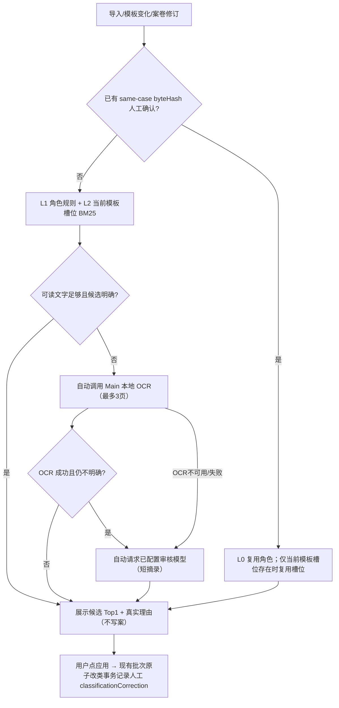

# 审核材料低成本分类 R01｜集成、自动触发与验证边界（2026-10-25）

> 后续整合（58 号）：Main 自动分类落案与 57 槽位补绑已合入，Renderer 的 `MaterialClassificationSuggestions` 组件已移除；本文以下记录的是 52 号分支当时的候选/自动触发边界，当前入口与合同以 [54](54-material-auto-classification-2ab-baseline-20261025.md)/[55](55-material-autoapply-remediation-unified-20261025.md)/[57](57-material-slot-auto-binding-remediation-20261025.md)/[58](58-material-autoapply-f05-integration-20261025.md) 为准。

## 0. 来源分支与本轮集成身份

- 源分支：`feat/c-material-classification-r01-20261025`，HEAD `47cbd46f7`；实质增量只有 `93adc1793`（本地分类 + 模型兜底）与 `47cbd46f7`（复用本地 OCR）。
- 源分支基于旧基线 `b8d27a15b`（其父 `31faead` 也是已迁移旧 UI），**不能直接覆盖当前整合版**。本轮在隔离工作树中逐文件移植，再复制回当前 canonical 工作树：
  - canonical `W=agent-ops/pr272-integration-20261025/worktrees/local-candidate`
  - 起始 HEAD `7b1898f56`（已含 PR272 + PR261），Electron `0.15.167`、shared `0.1.76`
  - 本轮备份：`R/classification-and-drag-20261025/before.patch`、`before-files.tar.gz`
- 本轮**没有**恢复旧的 `ReclassifyNativeWorkspaceDocumentV3` 单材料事务，也没有把旧原生改类事务覆盖到新合同上。当前正式写入仍走 `reclassifyNativeWorkspaceMaterialsV3` 批次原子事务（材料槽、acceptedRoles、格式、validity 撤销、计划/归档门禁原样保留）。
- 分支原文（旧 `CenterPanel` 内嵌建议、显式点击 OCR/AI）只作为来源记录；当前整合版 UI 由并行 B 负责挂载独立组件，A 不改 B 独占的四个 renderer 文件。

## 1. 本轮完成范围（含用户新增的自动触发要求）

用户在本轮明确覆盖“OCR/AI 必须逐个点击”的旧限制：分类改为导入/模板变化后**自动运行**；OCR 缺失时自动复用现有本地 OCR；仍不明确再自动调用现有审核模型网关。原“必须显式点击”的旧行为不再作为本轮交付口径。

| 层级 | 状态 | 真实行为 |
| --- | --- | --- |
| L0 人工经验复用 | 已接入 | 同一案卷内原件 SHA-256 相同且存在人工 `classificationCorrection` 时复用角色；槽位仅在当前模板版本仍含该 ID 时复用 |
| L1 角色规则 | 已接入 | 文件名、标题/表头、正文加权特征，输出 `rule/application/evidence` 候选与命中理由 |
| L2 模板槽位 | 已接入 | 当前模板名称/用途/关键要素/可选 `classificationHints` 的中文 n-gram + BM25 + 短语加减权 |
| L3 本地 OCR | 自动按需 | 材料为 `needs-ocr`（无可用文字/扫描件）时，组件自动调用 Main `CLASSIFY_MATERIAL_WITH_OCR`；复用现有系统 Tesseract `OcrPort` 与 `recognizeDocumentImages`，最多 3 张扫描页、单张 ≤12 MB；只读，不写 `blocks`/ParseRevision。本机已确认 `/usr/bin/tesseract 5.5.0` 且 `eng+chi_sim` 可用（合成图真实 CLI/适配器 smoke PASS，见 `R/classification-and-drag-20261025/ocr-env/OCR-DONE.json`） |
| L4 AI 兜底 | 自动按需 | OCR 后仍为 `ambiguous/unknown`，或 OCR 不可用/无文字时，自动请求**已配置的审核模型渠道**；Main 只发送文件名、最多 16 个非空块、正文 ≤2600 字、最多 20 个槽位描述；返回角色/槽位/理由并做白名单校验 |
| 自动写 Case | 本轮不做 | 自动流程**只生成候选**。用户仍点“应用建议”，经 B 的 `onApply` 走现有批次改类事务。这样机器候选不会被写成人工确认，也不引入第二套来源回执 |
| 人工确认保护 | 已接入 | 已有 `classificationCorrection` 的材料不进入自动 OCR/AI 队列；后台结果不会覆盖人工角色/槽位 |

关键口径：

- 自动 OCR/AI 属于**后台只读分析**，不写 Case、不提高规则效力、不产生审核通过结论。
- `classificationCorrection` 只在人工应用（批次改类）或 F05 人工纠错应用时写入，字段语义仍是“人把材料放到了哪里”，不是模型确认。
- 自动流程没有渠道/Key、网络失败、OCR 缺失时，如实显示错误/不可用状态；**不阻断上传、不阻断人工拖动与人工分类**。
- 默认不把“未知”静默推断为“否”；`unknown/ambiguous` 保持待确认。
- 模板匹配页默认只保留：当前材料摘要、自动推荐、手动模板搜索/选择、「使用此模板」；复杂配置（建案表单、上传/拖入、D4 对象表单、分类候选工作台、纠错面板、运行详情等）默认隐藏，唯一入口是匹配页底部的项目 Radix 左右滑动 `Switch`（`ReviewAdvancedOptionsToggle.tsx`）。审核设置页**不再**放置该开关（按用户最新要求删除那一段），只保留原审核模型设置；`showAdvancedOptions` 仍由 `ReviewModuleSettingsV2` 持久化（默认 `false`，旧配置缺字段 `false`）。开关只控制显示，不取消任何后端校验、警告或错误。

## 2. 与当前整合版的逐文件适配

1. `packages/shared/src/review/material-classifier.ts`
   - 纯函数 `classifyMaterialLocally`；无网络、无磁盘、无模型。`score` 是检索相关度，**不是概率**。
   - 输出 `manual-confirmed/high/ambiguous/needs-ocr/unknown`、最多 3 个角色候选、可选槽位、可核对的命中理由。
   - 人工已确认时不被覆盖；同字节经验只在同案、同模板槽位仍存在时复用。
2. `packages/shared/src/types/review.ts`、`review-v2.ts`
   - `SourceDocument.byteHash/classificationCorrection`、`MaterialAiSuggestion`、两个只读 IPC 通道。
   - `DocumentVersion.classificationCorrection` 允许 `attachment`（F05 人工纠错可把材料确认为附件）；旧三栏投影只传递三个可见角色，附件回执不进入 V1 投影。
   - `MaterialSlotSpec.classificationHints` 为可选；旧模板无此字段照常工作。
3. `apps/electron/src/main/lib/review/native-workspace-case-v3.ts`
   - `nativeWorkspaceProjectionV3` 传递真实 `byteHash` 与人工回执，供同案经验复用。
   - **保留** `reclassifyNativeWorkspaceMaterialsV3` 的批次原子、材料槽/格式/acceptedRoles、`revokeCurrentSourceValidity(...,'reclassify')`、计划/归档门禁；仅在同一 `mutate` 内补 `classificationCorrection: { role, materialSlotId, at }`，时间戳每次事务只取一次。
   - 不重新启用旧 `ReclassifyNativeWorkspaceDocumentV3`；单材料入口只是批次 API 的包装。
4. `apps/electron/src/main/lib/review/review-v3-remediation.ts`
   - 仅在 F05 人工纠错 apply 的 `mutate` 内补同一 `classificationCorrection` 回执；不放宽任何计划/归档/D2 校验。
5. `apps/electron/src/main/lib/review/case-import.ts`
   - 旧 V1 兼容导入补 `byteHash`；未恢复旧 `reclassifyDocumentInCase`（当前整合版已删除该路径）。
6. `apps/electron/src/main/lib/review/template-store.ts`
   - 校验 `classificationHints` 每类最多 32 项、每项 1~80 字普通短语；不执行正则/脚本。
7. `apps/electron/src/main/lib/review/material-classification-ocr.ts`
   - 抽出 `readMaterialOcrPages` 供自动流程与 AI 文字补齐共用；realpath 核验案卷边界、最多 3 页、12 MB 上限；失败返回 `unavailable/failed`，不编造文字。
8. `apps/electron/src/main/lib/review/material-classification-ai.ts`
   - Main 重新读取真实当前版本与模板；Renderer 只能传 `caseId/documentId`。
   - 无已保存文字时，Main 内部复用同一 OCR 只读识别后构造短摘录；OCR 失败仍只用文件名，不冒充已识别。
   - 只校验 `role/materialSlotId/rationale`，伪造槽位剔除；返回 `submittedChars`；不写 Case。
   - **沿用现有审核模块渠道设置**（用户当前为 `mimo-v2.6-flash`），本轮代码不硬编码、不切换模型。
9. `apps/electron/src/main/lib/review/review-ipc.ts`、`apps/electron/src/preload/index.ts`
   - 新增两个只读 IPC：`SUGGEST_MATERIAL_WITH_AI`、`CLASSIFY_MATERIAL_WITH_OCR`；均 `assertC0ReviewMainSender`；不提供任意路径/文本入参。
10. `apps/electron/src/renderer/components/content-review/MaterialClassificationSuggestions.tsx`
    - 默认导出 `MaterialClassificationSuggestions`，props 固定为 `{ aggregate, onApply }`；`onApply` 入参 `{documentVersionId, role:'rule'|'application'|'evidence', materialSlotId?}`。
    - 默认折叠为一行“材料分类建议（N 项待确认）”；展开显示真实文件名、当前栏位/槽位、Top 候选、命中理由/模型理由；不显示概率。
    - `useEffect` 在导入/模板变化/案卷修订后自动跑 L0/L1/L2；稳定 `planKey` 防止 render→请求循环。
    - 并发 3；按 `caseId + byteHash(或 versionId) + templateId + templateVersion + parseRevision` 去重与缓存；失败材料进入 attempted 集合，不自动无限重试、不反复计费。
    - 切案/版本变化用 generation + caseId + versionId 校验丢弃迟到结果；旧模板结果不覆盖当前。
    - 人工确认材料跳过自动队列；自动结果只是候选，仍由用户点“应用建议”走 `onApply`。
11. `apps/electron/src/renderer/components/content-review/material-classification-suggestions-model.ts`
    - 纯函数 `buildMaterialSuggestionRows`：人工确认优先、AI/OCR 只作为候选、需要 OCR 的行保留给自动流程；独立测试不依赖 DOM/IPC。

12. `apps/electron/src/renderer/components/content-review/ReviewAdvancedOptionsToggle.tsx`（B 所有，A 只验收字节）
    - Jotai `reviewAdvancedOptionsAtom` + hydration/touched 守门；复用 `@profer/ui/primitives/switch`（Radix），无新依赖、无 localStorage。
    - 保存走既有 `getModuleSettingsV2`/`saveModuleSettingsV2`：先读当前设置再写，保留 `agentModelSelection`；旧 Main 返回非布尔时回滚并提示需重启，不伪造成功。
    - 唯一入口为材料匹配页底部；`ReviewV3LocalCandidateWorkbench.tsx` 负责渲染，`ReviewV3TemplateRoutingAssistant.tsx` 只读 `show` 决定高级容器显示。设置页 `ReviewSettingsPanel.tsx` 相对 HEAD 无 diff。

## 3. 自动分类流程

示例（仅解释规则，不是准确率声明）：`全国材料设计竞赛获奖证书.pdf` 含“获奖等级/颁发单位”，优先证明材料并对齐当前模板“竞赛获奖证明”；`奖学金评选细则与工作通知.pdf` 标题/规则文书特征优先审核依据；`IMG_1025.png` 无文本层时先自动 OCR，OCR 不可用则如实显示并仅用文件名生成保守候选。

必须区分四类事实：**文件归类候选**、**原件身份（Main 的 byteHash/版本）**、**规则效力（制度版本/授权）**、**业务结论（Pi/人工/正式决定）**。候选 `high` 不代表 OCR 可靠、政策 VERIFIED、Check PASS 或 BusinessDecision。

## 4. 本轮真实测试与验证边界

在隔离工作树 `R/worktrees/classification-core`（canonical `7b1898f56` + 已备份 dirty 基线，Bun 1.4.0）执行：

| 命令或用例 | 结果 |
| --- | --- |
| `bun test`（classifier/AI/OCR/建议模型/native-workspace-case-v3/review-v3-remediation/module-settings-store） | **47 通过，0 失败，222 次断言** |
| `bun test`（review-model-gateway / model-gateway-probe / preupload-gate.p0 / review-actions-controller / template-route / workspace-view-model） | **74 通过，0 失败，253 次断言** |
| `bun run --filter='@profer/shared' typecheck` | PASS（`tsc --noEmit`，exit 0） |
| `bun run --filter='@profer/electron' typecheck` | PASS（`tsc --noEmit`，exit 0） |
| `bun scripts/check-boundaries.ts` | PASS，无边界违规 |
| `git diff --check` | PASS |

覆盖点：申请表/政策通知互斥、竞赛证书槽位、无文本图片待 OCR、同案同哈希人工经验复用、人工确认不被覆盖、模板换版后旧槽位不复用、未知不制造槽位、OCR 页数/图片原件兜底/失败不编造/不改原件、AI 摘录上限与输出校验、原生批次改类保留版本身份并写人工回执、投影传递 byteHash/回执。

**未完成/未声称**：

- 没有真实标注集的准确率评测，不能写“准确率 X%”。
- 没有 Electron GUI 自动验收；拖拽、模板匹配默认收起与底部 Switch 均由用户自测，GUI 状态记为“用户待验”，不是 PASS。B 的 `UI-DONE-v2.json` 明确 `USER_WILL_TEST`。
- OCR 是否可用取决于目标机 `tesseract` + `chi_sim`；本轮不并行 apt 安装、不新造 OCR 引擎（另派 DSH 环境任务）。缺失时只显示不可用并继续回退模型（文件名/已有摘录）。
- 自动模型请求已获用户授权；但仍可能计费，仅在本地/OCR 不明确时发送短摘录。未实现按 token 预算的硬限额，`submittedChars` 不是 token。
- 自动流程不自动写 Case；因此没有“机器自动应用”来源。若将来启用自动写，必须新增独立来源字段，不能复用人工 `classificationCorrection`。

## 5. 已知边界

1. 权重与 `high` 阈值是保守工程启发式，未校准；需要跨领域/跨模板真实样本统计 Top-1/Top-3/误归类率/待确认率/延迟。
2. OCR 只读取扫描页，不写解析块；正式证据仍需受控解析命令写入带来源版本与坐标的文本。
3. 不改 B3 模板路由；模板选择前的粗分类不能绕过 B3 的保守门禁。
4. 一份原件覆盖多个事项时仍只有一个 `materialSlotId`；未来需不可变原件 + 多对多逻辑引用/页段证据。
5. 旧 V1 案卷仍不支持从建议卡片直接重绑 V2 槽位。
6. 自动 AI 依赖现有审核网关；无渠道/Key 时如实失败，上传和人工分类不受影响。模型选择沿用现有审核设置，不在本轮代码切换。
7. `showAdvancedOptions` 只是显示层开关：默认隐藏复杂配置不等于放宽建案、D4、计划、归档或材料槽校验；设置页不再有第二入口，只有匹配页底部 Switch。
8. 未修改 `AGENTS.md` / `README.md`（需另行授权）；专项文档足够记录本轮范围。

## 6. 回滚与合并条件

- 移除建议组件或两个只读 IPC 即回到纯人工分类；已存在的原生材料、Run、计划不受影响。
- `byteHash`、`classificationCorrection`、`classificationHints` 均为可选字段，旧数据可继续读取。
- 最终以 canonical 实际字节为准；合并后必须重跑受影响门禁（shared/electron typecheck、classifier/AI/OCR/原生批次/拖拽相关聚焦测试、boundaries、diff-check）。局部 PASS 不等于生产放行或学校授权通过。
